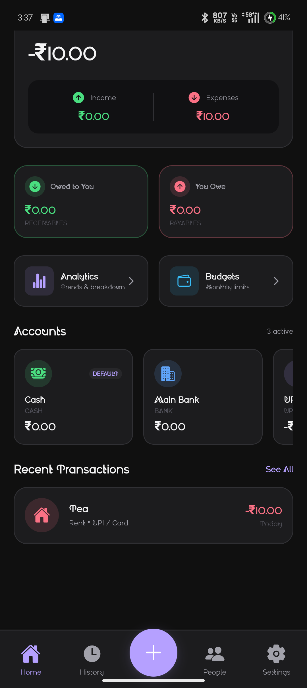
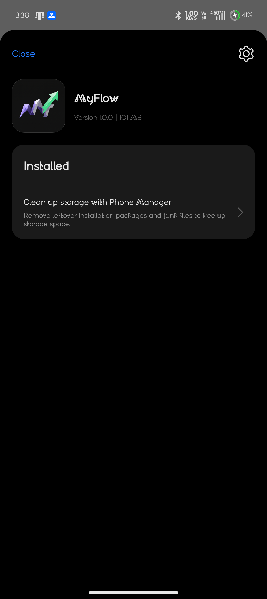
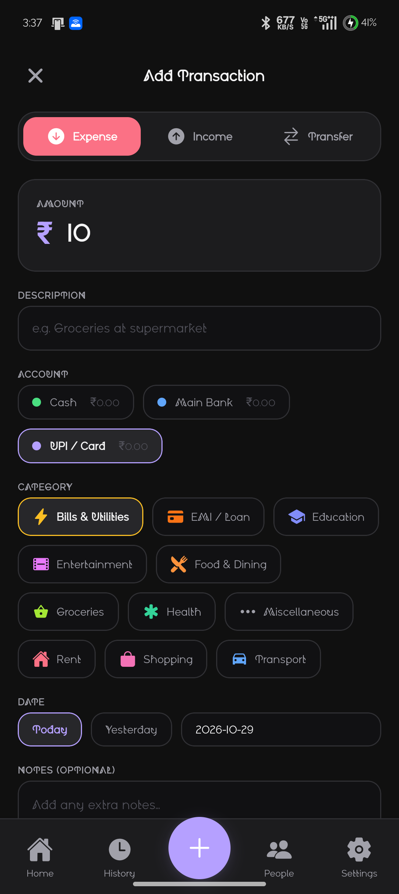

# MyFlow

### Your Money. Your Flow.

A personal finance and expense management application built with React Native, Expo, and TypeScript.

MyFlow helps you manage your income, expenses, budgets, transactions, and personal lending — all in one place.

---

## ✨ Features

- **Dashboard** – Overview of your financial activity.
- **Income & Expenses** – Track daily transactions.
- **Transaction History** – Review your financial records.
- **People & Loans** – Manage lending, borrowing, and partial repayments.
- **Analytics** – Visualize spending patterns and financial trends.
- **Budget Management** – Set budgets and monitor expenses.
- **Backup & Restore** – Export and restore financial data.
- **Daily Notifications** – Receive financial reminders.
- **Offline-first** – Access your financial records without requiring an internet connection.

## 🎨 Design

MyFlow features an **Obsidian Minimal Dark** theme, with a clean interface, subtle surfaces, and a focused financial dashboard.

## 🛠️ Tech Stack

| Technology | Purpose |
|---|---|
| React Native | Mobile application framework |
| Expo | Development and build tooling |
| TypeScript | Type-safe development |
| Expo Router | Navigation |
| SQLite | Local database |
| React Native Safe Area Context | Safe area handling |

## 📱 Screenshots

<p align="center">
  
  
  
</p>

## 📂 Project Structure

```text
MyFlow/
├── android/             # Native Android project
├── assets/              # App icons and assets
├── src/
│   ├── app/             # Screens and navigation
│   ├── components/      # Reusable UI components
│   ├── constants/       # Theme and categories
│   ├── db/              # SQLite repositories and schema
│   ├── services/        # Notifications and backup
│   ├── types/           # TypeScript definitions
│   └── utils/           # Utility functions
├── tests/               # Automated tests
├── app.json
├── package.json
└── README.md
```

## 🚀 Getting Started

### Prerequisites

- Node.js
- npm
- Android Studio and Android SDK
- Java Development Kit (JDK)

### Installation

Clone the repository:

```bash
git clone https://github.com/abhinandan068/MyFlow.git
```

Navigate to the project:

```bash
cd MyFlow
```

Install dependencies:

```bash
npm install
```

Start the Expo development server:

```bash
npx expo start
```

### Build Android APK

On Windows:

```powershell
cd android
.\gradlew.bat assembleRelease
```

APK output:

```text
android/app/build/outputs/apk/release/app-release.apk
```

## 📦 Download

Get the latest Android APK from:

[**MyFlow Releases**](https://github.com/abhinandan068/MyFlow/releases)

## 🔒 Privacy & Storage

- Financial records are stored locally using SQLite.
- No mandatory account or cloud synchronization.
- Designed for offline use.
- Backup and restore functionality is available.

## 🧪 Testing

Automated tests cover financial calculations, transactions, people, analytics, budgets, and date utilities.

## 🗺️ Roadmap

- [x] Income and expense tracking
- [x] Transaction history
- [x] People and loan management
- [x] Analytics and budgets
- [x] Local database persistence
- [x] Backup and restore
- [ ] Further UI refinements
- [ ] Additional financial insights

## 🤝 Contributing

Suggestions, bug reports, and feature requests are welcome. Feel free to open an issue or submit a pull request.

## 📄 License

No license has been specified yet. All rights reserved unless a license is added to this repository.

---

<p align="center">
  <strong>MyFlow</strong><br/>
  Your Money. Your Flow.
</p>
